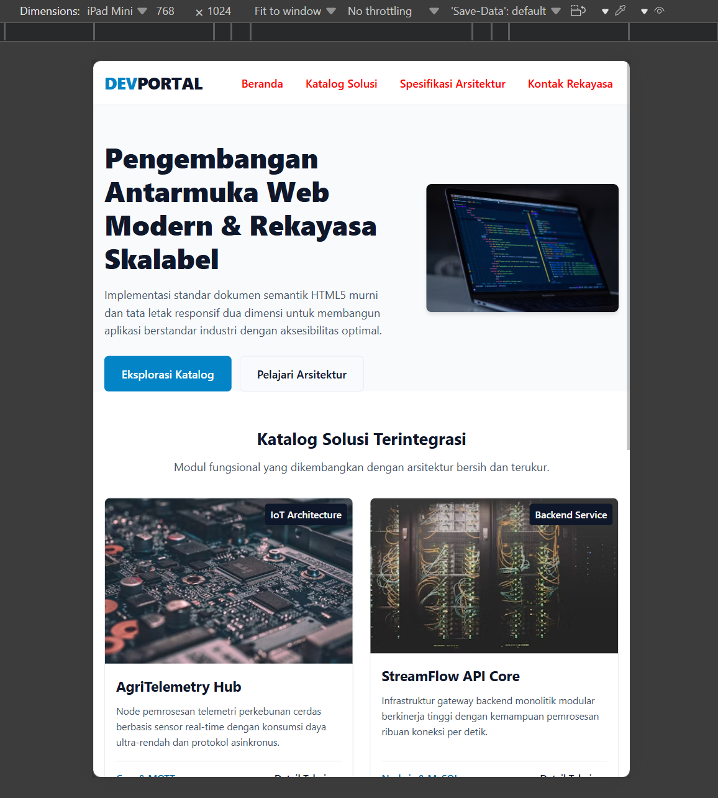
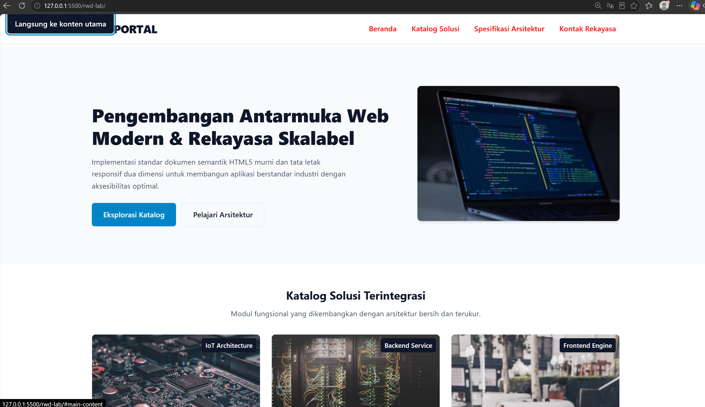

readme

# Laporan Praktikum Responsive Web Design (RWD)

Dokumentasi dan logbook pengujian integritas kode untuk laboratorium pemrograman web modern.

Creator : Bayu Trias (42530019)

---

## 📋 Matriks Penelusuran Pengujian (Traceability Matrix)

Berikut adalah laporan pengujian tampilan visual dan adaptivitas aplikasi terhadap berbagai resolusi layar (viewport):

| ID Uji | Fitur / Komponen | Lebar Viewport Pengujian | Ekspektasi Tampilan Antarmuka | Hasil Pengujian Aktual | Status (Pass/Fail) | Bukti Tanggap Layar |
| :---: | :--- | :--- | :--- | :--- | :---: | :---: |
| **TC-01** | Navigasi Menu | Mobile (360px – 480px) | Menu membungkus (*wrap*) rapi, tidak terpotong, teks terbaca proporsional | Sesuai ekspektasi | **Pass** |   |
| **TC-02** | Hero Section | Breakpoint Tablet (768px) | Berubah dari susunan 1 kolom vertikal menjadi tata letak seimbang | Sesuai ekspektasi | **Pass** |  |
| **TC-03** | Grid Katalog | Resize Dinamis (360px – 1920px) | Kolom bertambah otomatis secara *fluid* tanpa kemunculan *horizontal scrollbar* | Sesuai ekspektasi | **Pass** |   |
| **TC-04** | Navigasi Keyboard | Papan Ketik (Tombol Tab) | *Skip-link* muncul di sudut kiri atas saat menerima fokus | Sesuai ekspektasi | **Pass** |  |

---

## 🛠️ Catatan Perbaikan & Investigasi Kode

### 1. Penanganan *Flexbox* & *Grid Overflow*
- **Akar Masalah:** Kartu produk mengalami pelebaran tidak normal karena teks token yang panjang tanpa jeda spasi.
- **Perbaikan:** Menyisipkan `min-width: 0 pada .product-card serta mengatur overflow-wrap: anywhere pada elemen paragraf terkait.

### 2. Mengatasi *Margin Collapse*
- **Akar Masalah:** Terjadinya kebocoran margin vertikal bagian atas pada elemen `.hero-section__title`.
- **Perbaikan:** Mengaktifkan *Block Formatting Context* (BFC) baru dengan menerapkan `display: flow-root` atau `overflow: clip` pada kontainer induk    .hero-section`.

### 3. Optimalisasi Spesifisitas CSS (Metodologi BEM)
- **Akar Masalah:** Hover` gagal dieksekusi akibat selektor berantai yang terlalu spesifik (`header nav ul li a`).
- **Perbaikan:** Merampingkan selektor dengan memanfaatkan kelas BEM murni `.primary-nav__link` beserta state hover`-nya tanpa menyertakan rantai tag HTML.

---

## 🚀 Cara Menjalankan Proyek

1. *Clone* repositori ini:
   ```bash
   git clone https://github.com/BayuuuTriasss/PemWeb-1-rwd-Lab-42530019.git
2. *Masuk* kedalam folder
    ```bash
   cd rwd-lab
3. *Buka* project
    ```bash 
    code . 
    ```
4. *View* project 
    ```bash
    live server